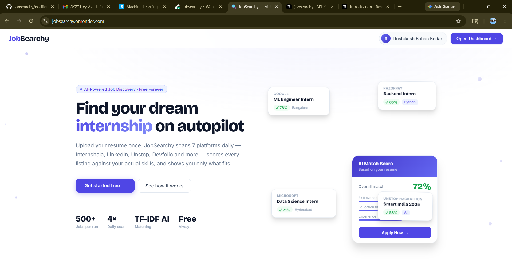
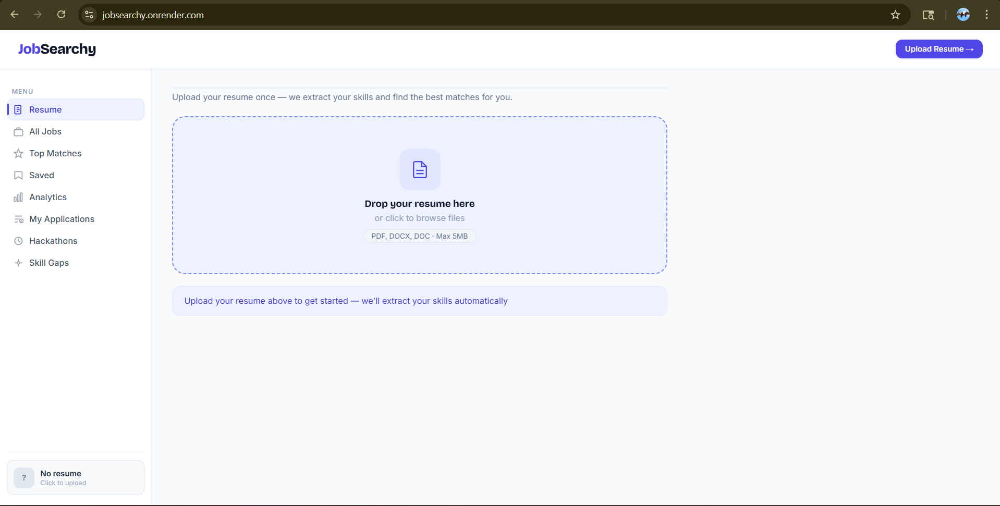
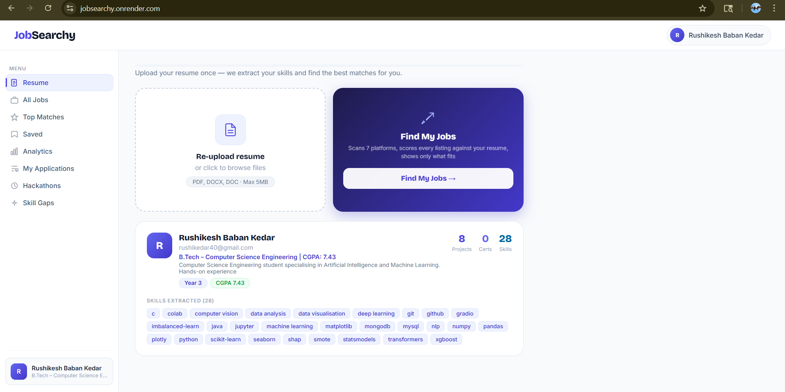
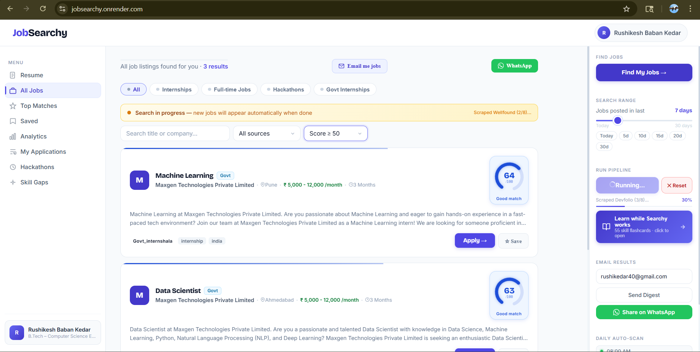
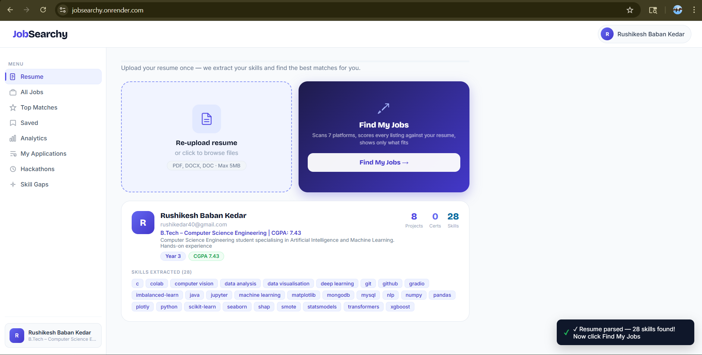
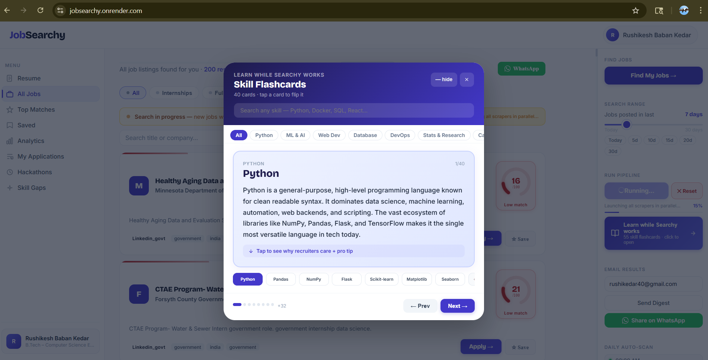
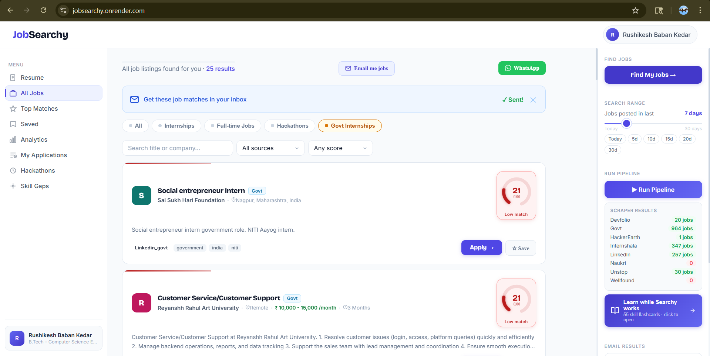

# 🔍 JobSearchy — Autonomous AI Job Discovery Agent

<p align="center">
  <a href="https://github.com/Rushi9234/jobsearchy/actions/workflows/ci.yml">
    
  </a>
  
  <a href="https://jobsearchy.onrender.com">
    
  </a>
  
  
</p>

> **Most job boards make you search. JobSearchy searches for you.**  
> Upload your resume once &rarr; scrapes verified jobs across 9 platforms &rarr; AI scores every job 0–100 with skill coverage against your resume &rarr; dispatches instant WhatsApp and HTML email digests.

**🌐 Production Deployment:** [jobsearchy.onrender.com](https://jobsearchy.onrender.com)

---



---

## 🎯 Key Capabilities

- **⚡ Multi-Engine Scraping (9 Portals in Parallel):**
  Scrapes active listings across Internshala, LinkedIn, Wellfound, Unstop, Devfolio, HackerEarth, Naukri, verified Government portals (AICTE, ISRO, DRDO, IITs, NITI Aayog), and the official Prime Minister Internship Scheme (PMIS).
- **📅 Real-Time Search Range Slider & Days Filter:**
  Adjust search window seamlessly (`Today`, `3d`, `7d`, `15d`, `30d`) from the drawer slider or top filter pills. Only listings within your requested range are displayed and emailed.
- **🏛️ 100% Verified Government Opportunities:**
  Strict validation ensures only official government bodies, national labs, IIT research programs (SURGE, SPARK), and ministry schemes (PMIS) appear in the Government category—zero private company leakage.
- **🟢 Freshness Badges:**
  Every listing shows a visual freshness indicator (`🟢 Today`, `🔵 2d ago`, `🟡 5d ago`) calculated dynamically.
- **🎯 AI Matching & Skill Coverage Scoring (0–100):**
  Hybrid TF-IDF semantic matching + skill coverage breakdown calculating exact match percentage, matched skills, and skill gaps for every position.
- **🧭 Career GPS Matrix:**
  AI-powered career path recommendation engine mapping your extracted profile to high-trajectory roles, readiness ratings, and personalized 7-day action plans.
- **🤖 Joby AI Copilot:**
  Built-in conversational career assistant ready to answer questions about specific postings, skills to learn, interview preparation, and application strategy.
- **🎨 3 Designer Themes:**
  Switch in 1 click between **Classic**, **Obsidian Dark**, and **Porcelain Light**.
- **📨 Multi-Channel Alerts:**
  Personalized HTML email digests (via Resend HTTPS REST API or Gmail SMTP) + WhatsApp deep link + Telegram alerts.

---

## 📸 Product Walkthrough

### 1. Resume Upload & Instant Parsing
Drop your resume (PDF, DOCX, DOC) — skills, projects, degrees, and candidate details are extracted automatically.


---

### 2. Candidate Profile Calibration
Over 25+ skills extracted with candidate headline, CGPA, and one-click "⚡ Demo Profile" fallback for instant testing.


---

### 3. Live Dashboard with Real-Time Filters & Arc Gauges
Visual 0–100 match gauges, live progress indicator, freshness badges, and real-time category filtering (Internships, Full-time, Hackathons, Govt).


---

### 4. Domain-Aware Skill Gap Analysis
Identifies high-frequency industry skills missing from your resume and provides direct learning links.


---

### 5. Interactive Skill Flashcards
Interactive flashcards across 7 technical disciplines (Python, ML/AI, Web Dev, DevOps, Database, Stats) to review core concepts while pipeline runs.


---

### 6. Personalized Email Digest
Rich HTML email with top scoring opportunities, skill gap advisory, and direct 1-click apply links.


---

## ⚙️ How the Pipeline Works

```
Resume (PDF/DOCX) or ⚡ Demo Profile
         │
         ▼
[Resume Parser] ───► profile.json (Skills, Education, Experience)
         │
         ▼
[Parallel Scraping Engine] ───► 9 sources (LinkedIn, Internshala, PMIS, Unstop, etc.)
         │                      (Filtered by active Search Range: Today / 7d / 30d)
         ▼
[Strict Classification & Anti-Spam] ───► Discards spam, validates real govt entities
         │
         ▼
[AI Matcher + Skill Coverage] ───► Semantic TF-IDF + Skill Overlap (0–100 Score)
         │
         ├──► Dashboard UI (Real-time reactivity + Arc Gauges)
         ├──► WhatsApp 1-Tap Share
         └──► Email Digest (Resend API / SMTP)
```

---

## 🛠️ Tech Stack

| Layer | Technologies |
|-------|--------------|
| **Backend** | Python 3.11+, Flask, Gunicorn (gthread workers) |
| **Frontend** | React 18 (CDN), Babel, Lucide icons, Pure CSS (No npm/build overhead) |
| **AI & NLP** | scikit-learn (TF-IDF Vectorizer & Cosine Similarity), pdfplumber, python-docx |
| **Scraping** | Requests, BeautifulSoup4, urllib3 (with rate limiting & session pooling) |
| **Database** | SQLite3 / Turso LibSQL cloud support (WAL mode, parameterized queries) |
| **Email Delivery** | Resend API (HTTPS REST — bypasses port blocks) & Gmail SMTP (SSL 465) |
| **Container & CI** | Docker, Docker Compose, GitHub Actions, Render Cloud Web Service |

---

## 🔧 Local Development & Setup

### Option 1: Direct Python Virtualenv

```bash
# 1. Clone the repository
git clone https://github.com/Rushi9234/jobsearchy.git
cd jobsearchy

# 2. Create & activate virtual environment
python -m venv venv
# Windows:
venv\Scripts\activate
# Linux/macOS:
source venv/bin/activate

# 3. Install dependencies
pip install -r requirements.txt

# 4. Configure environment variables
cp searchy.env.example searchy.env
# Edit searchy.env with your optional keys (RESEND_API_KEY, TELEGRAM_BOT_TOKEN, etc.)

# 5. Run the web portal
python web_portal.py
# Open http://localhost:5000 in your browser
```

### Option 2: Docker

```bash
# Build and run container locally
docker build -t jobsearchy .
docker run -p 5000:5000 --env-file searchy.env jobsearchy
```

---

## 🧪 Testing

JobSearchy comes with a comprehensive automated test suite covering all endpoints, parsers, scrapers, and AI matching:

```bash
# Run full unit test discover
python -m unittest discover tests -v
```

---

## 🔑 Environment Variables Reference

Create a `searchy.env` file in the root directory:

```env
# Email Delivery (Recommended: Resend HTTPS API for reliable cloud delivery)
RESEND_API_KEY=re_your_api_key_here
MAIL_FROM=notifications@yourdomain.com

# SMTP Fallback (Optional)
MAIL_TO=recipient@example.com
SMTP_HOST=smtp.gmail.com
SMTP_PORT=465
MAIL_PASS=your_gmail_app_password

# Telegram Bot (Optional)
TELEGRAM_BOT_TOKEN=your_telegram_bot_token
TELEGRAM_CHAT_ID=your_telegram_chat_id

# Optional Cloud Database (Turso LibSQL for persistent cloud container storage)
TURSO_DATABASE_URL=
TURSO_AUTH_TOKEN=
```

---

## 📄 License

This project is licensed under the [MIT License](LICENSE).
