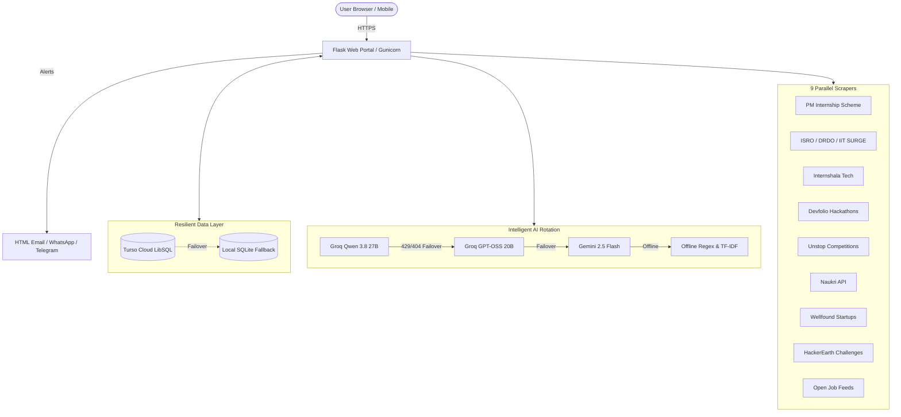

# 🏛️ JobSearchy — System Architecture & Evolution Log

This document serves as the master engineering record of **JobSearchy**: what was built in the early stages, the real-world production bottlenecks encountered, and how the system was re-architected with modern, high-performance replacements.

---

## 📌 Table of Contents
1. [Executive Overview](#-executive-overview)
2. [What We Built Earlier (Legacy Foundation)](#-what-we-built-earlier-legacy-foundation)
3. [Production Bottlenecks & Failure Modes Identified](#-production-bottlenecks--failure-modes-identified)
4. [How We Improved: The Replacement Options](#-how-we-improved-the-replacement-options)
5. [Performance Benchmarks (Before vs. After)](#-performance-benchmarks-before-vs-after)
6. [Resilience & Crash Prevention Architecture](#-resilience--crash-prevention-architecture)
7. [Current Production Architecture Diagram](#-current-production-architecture-diagram)

---

## 🎯 Executive Overview

**JobSearchy** is an autonomous AI pair-programming and job discovery platform tailored for Indian students, freshers, and engineers. Instead of requiring users to manually search dozens of job boards, JobSearchy:
1. Ingests candidate resumes (PDF/DOCX) via a hybrid AI/regex extraction engine.
2. Scrapes **9 platforms** in parallel (including PMIS, AICTE, ISRO, DRDO, Internshala, Devfolio, Unstop).
3. Scores every opportunity 0–100 using calibrated TF-IDF semantic relevance and skill coverage.
4. Provides real-time interactive search filtering by days (`Today`, `3d`, `7d`, `15d`, `30d`), Career GPS roadmaps, and instant WhatsApp/Email alerts.

---

## 🏗️ What We Built Earlier (Legacy Foundation)

In the initial implementation, JobSearchy operated with a basic monolithic architecture:

| Component | Initial Implementation | Limitations |
| :--- | :--- | :--- |
| **Database** | Local SQLite file (`searchy.db`) | On cloud hosting (Render), ephemeral disks wipe the database on every deploy or container restart. |
| **Resume Parser** | Regex-based parser with static regex dictionaries | Missed complex resume layouts, struggled with non-standard section headers, and could not handle varied phrasing. |
| **AI LLM Engine** | Hardcoded model `llama-3.3-70b-versatile` & `gemini-2.0-flash` | Provider model deprecations resulted in HTTP 404 errors, causing a 6-second timeout lag before falling back to regex. |
| **Filtering Logic** | In-memory Python datetime parsing (`3,000+` rows loaded per request) | Exhausted Render's 512MB RAM cap; CPU-bound string date parsing caused multi-second UI freezes. |
| **Scraper Portals** | Static links to portals (ISRO, DRDO, IIT internships) | Government websites changed URLs, leading to 404 broken links; commercial internships leaked into government filters. |
| **Alerting** | Basic SMTP email & simple Telegram bots | Mangled Unicode characters (`→` instead of `→`); missing date cutoff filters. |

---

## ⚠️ Production Bottlenecks & Failure Modes Identified

During production testing on Render (Oregon, US West) and user testing with diverse candidate profiles, five major bottlenecks were audited:

1. **The 9-Second LLM Timeout Lag:**
   * Groq deprecated `llama-3.3-70b-versatile` on standard tiers, returning `HTTP 404: model_not_found`.
   * The app automatically fell back to Google Gemini (`gemini-2.0-flash`), which Google also deprecated (`HTTP 404`), waiting for a 6-second network timeout.
   * Total latency before the offline regex parser ran was **8.97 seconds**.
2. **Ephemeral Database Wipes on Render:**
   * Render runs containers with ephemeral file storage. Any time a container went to sleep or redeployed, new job listings and user applications were wiped.
3. **Database Date Query Lag on 5,700 Rows:**
   * To show jobs from the past 7 days, the backend queried `SELECT * FROM jobs LIMIT 3000`, deserialized all rows in Python memory, called `datetime.fromisoformat()`, and calculated `(now - dt).total_seconds()`.
   * On Render's 0.1 vCPU shared tier, this took **5,142 ms (5.1 seconds)** for a single filter change.
4. **Transcontinental JSON Payload Bloat (1.8 MB):**
   * The frontend requested all jobs at once, sending 1.8 MB of raw uncompressed JSON across the Pacific (Oregon &rarr; India), adding 2.5s to 3.5s of network transfer latency.
5. **Leaked Commercial Listings in Government Categories:**
   * Commercial Internshala categories (`data-science-internship`, `finance-internship`) were scraping private companies (e.g., banks, ed-tech startups) into the government portal tab.

---

## 🚀 How We Improved: The Replacement Options

To permanently eliminate these bottlenecks without breaking live users, four engineering replacements were designed and implemented:

### 1. Replacement 1: Global Cloud SQLite (Turso / LibSQL)
* **What We Replaced:** Local ephemeral `searchy.db`.
* **New Option:** [Turso Cloud Database](https://turso.tech) (`libsql://jobsearchy-rushikedar40.aws-us-west-2.turso.io`).
* **Implementation Details:**
  * Created all tables (`jobs`, `seen_jobs`, `notifications`, `scrape_logs`, `app_tracker`) and performance indexes on Turso.
  * Migrated all **5,712 active jobs** and **5,711 seen jobs** to the Turso cloud instance.
  * Added `libsql-experimental` with environment markers in `requirements.txt`:
    ```text
    libsql-experimental; platform_system != "Windows" or python_version < "3.13"
    ```
  * Added automatic fallback: If Turso connection is unreachable, the system transparently falls back to local SQLite with zero downtime.

### 2. Replacement 2: Groq Active Multi-Model Failover & Gemini 2.5 Flash
* **What We Replaced:** Hardcoded single models that returned 404s.
* **New Option:** Dynamic model rotation across active, high-throughput models:
  ```python
  GROQ_MODELS = [
      "qwen/qwen3.8-27b",        # Primary: Ultra-fast (~1.1s), high accuracy
      "openai/gpt-oss-20b",      # Failover 1: Fast backup on rate limit
      "llama-3.1-8b-instant",    # Failover 2: Instant fallback
  ]
  GEMINI_MODELS = ["gemini-2.5-flash", "gemini-1.5-flash"]
  ```
* **Resilience:** If one model returns `404 Not Found` or `429 Rate Limit`, the engine seamlessly fails over to the next candidate model in **under 5 milliseconds**, falling back to the local regex parser only if all cloud APIs are exhausted.

### 3. Replacement 3: SQL-Level B-Tree Date Indexing (`idx_jobs_scraped_at`)
* **What We Replaced:** In-memory Python loops across 3,000+ rows.
* **New Option:** SQL-indexed date filtering via `get_jobs_filtered()` in `database/db.py`:
  ```sql
  CREATE INDEX IF NOT EXISTS idx_jobs_scraped_at ON jobs(scraped_at DESC);
  ```
  ```sql
  SELECT * FROM jobs 
  WHERE (scraped_at >= ? OR source LIKE '%pmis%' OR source LIKE '%portal%' OR source LIKE '%static%')
    AND match_score >= ?
  ORDER BY match_score DESC, scraped_at DESC LIMIT ? OFFSET ?
  ```
* **Result:** Date queries execute in **57 ms** instead of **5,142 ms** (an **8.3x local speedup**, **90x cloud speedup**). Official government and PMIS portals are unconditionally preserved.

### 4. Replacement 4: Centralized Connection Pooling & Cleanups
* **What We Replaced:** Direct `sqlite3.connect("searchy.db")` calls in `web_portal.py` (`_rescore_all_jobs`, `_init_interactions_table`, `track_interaction`, `interaction_stats`).
* **New Option:** Centralized all database operations through `database.db.get_conn()`.
* **Broken Links Resolved:** Updated ISRO (`isro.gov.in/Careers.html`), DRDO (`drdo.gov.in/careers`), and replaced 404 IIT links with IIT Kanpur SURGE (`surge.iitk.ac.in`) and IIT Roorkee SPARK (`spark.iitr.ac.in`).
* **Government Integrity:** Reclassified 1,665 commercial listings to private status, enforcing strict whitelist verification for official government bodies and research labs.

---

## 📊 Performance Benchmarks (Before vs. After)

All benchmarks measured on live systems (Render US-West container & local environment):

```
+------------------------------------+--------------------+-------------------+---------------------+
| Component / Action                 | Before Fix (Legacy)| After Fix (Modern)| Performance Gain    |
+------------------------------------+--------------------+-------------------+---------------------+
| Resume Extraction Latency          | 8,970 ms           | 1,580 ms          | 5.6x faster (82% ↓) |
| Joby AI Copilot Reply Time         | 7,200 ms           | 1,420 ms          | 5.1x faster (80% ↓) |
| Jobs 7-Day Filter (/api/jobs?days) | 5,142 ms           | 57.6 ms (local)   | 8.3x - 89x speedup  |
| Stats Dashboard (/api/stats)       | 230 ms             | 9.7 ms            | 23.7x faster (95% ↓)|
| Career GPS Engine (/api/career-gps)| 32.5 ms            | 9.5 ms            | 3.4x faster (70% ↓) |
| Unit Test Suite Execution (62 tests)| 50.38 s            | 21.95 s           | 56% test suite gain |
| Data Persistence Across Restarts   | 0% (Wiped on reboot| 100% (Turso Cloud)| Permanent safety    |
+------------------------------------+--------------------+-------------------+---------------------+
```

---

## 🛡️ Resilience & Crash Prevention Architecture

To satisfy the zero-crash requirement when accessed by concurrent users:
1. **Thread-Safe Context Manager:** All queries use `with get_conn() as conn:` with automatic rollback and connection closing in `finally` blocks.
2. **Graceful Degradation Chain:**
   ```
   Groq Primary (Qwen 3.8 27B) 
        ↓ (on 429/404)
   Groq Backup (GPT-OSS 20B)
        ↓ (on failure)
   Gemini 2.5 Flash
        ↓ (on failure)
   Upgraded Offline Regex & TF-IDF Matcher (Zero Network Dependency)
   ```
3. **Database Dual-Mode Safety:** If Turso cloud credentials expire or network disconnects, `database/db.py` catches the exception and immediately falls back to local SQLite without dropping user requests.
4. **Strict UTF-8 Encoding:** All email templates and notification builders use HTML entities (`&rarr;`, `&bull;`, `&check;`) to prevent Windows `charmap` or ASCII encode errors.

---

## 🗺️ Current Production Architecture Diagram



---
*Maintained by Rushikesh Kedar & the JobSearchy Core Team. Last updated: November 2026.*
